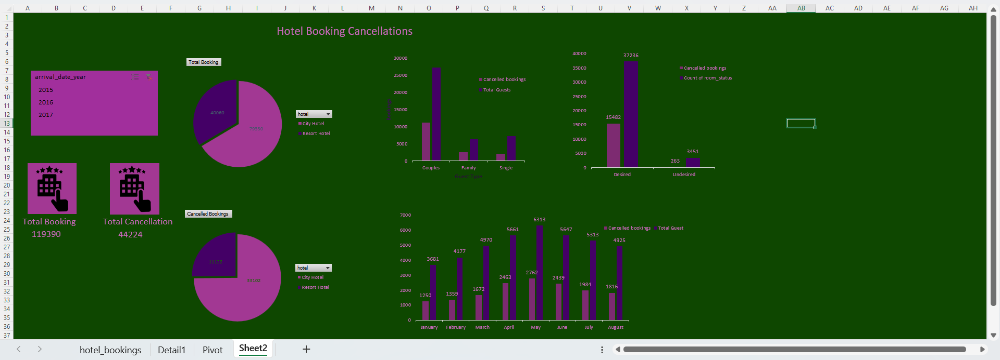

# 👋 Hi, I'm Sudha Mishra!

### MCA Student | Aspiring Data Analyst | Graphic Designer

📍 Ayodhya, Uttar Pradesh, India

---

# 👩‍💻 About Me

Hello! I'm Sudha Mishra, an MCA student passionate about Data Analytics, Technology and Graphic Designing.

I enjoy exploring new technologies, analyzing data, creating designs and developing practical projects.

- 🎓 Currently pursuing Master of Computer Applications (MCA).
- 📊 Interested in Data Analytics and Data Visualization.
- 💻 Knowledge of Python, C, HTML, CSS and MySQL.
- 🎨 Experienced in Graphic Designing.
- 🌱 Always learning and improving my technical skills.
- 🎯 Aspiring to build a career as a Data Analyst.
- 🤝 Quick learner with communication and problem-solving skills.

---

# 💼 Professional Experience

### Graphic Design Intern
**SGTYUG Technologies Pvt. Ltd.**

📅 May 2025 – October 2025 | 6 Months

**Tools:** Adobe Photoshop, Adobe Illustrator, Canva

- Created logos, posters, banners and social media designs.
- Worked on graphic designing using Photoshop, Illustrator and Canva.
- Worked on video editing.
- Developed creative thinking and problem-solving skills.
- Collaborated with team members to complete projects on time.

---

# 🎓 Education

### Master of Computer Applications (MCA)
Dr. Ram Manohar Lohia Avadh University, Ayodhya

2026 – 2028

### Bachelor of Computer Applications (BCA)
Dr. Ram Manohar Lohia Avadh University, Ayodhya

2023 – 2026

---

# 🚀 My Projects

## 📊 1. Hotel Booking Cancellation Analysis

**Category:** Data Analytics

An Excel-based data analytics project focused on analyzing hotel bookings and cancellation trends through an interactive dashboard.

### Tools & Technologies
- Microsoft Excel
- Pivot Tables
- Pivot Charts
- Data Visualization
- Interactive Filters

### Key Analysis
- Total Hotel Bookings
- Total Booking Cancellations
- City Hotel vs Resort Hotel Analysis
- Customer Type Analysis
- Deposit Type Analysis
- Monthly Booking Trends
- Year-wise Booking Analysis

### Project Objective

To analyze hotel booking data, understand cancellation patterns and identify booking trends through data visualization.

### Dashboard Preview

---

## 🛒 2. GreenCart – Grocery E-commerce Application

An online grocery e-commerce web application designed to provide users with a convenient online shopping experience.

### Technologies Used
- HTML
- CSS
- JavaScript
- React
- Node.js
- Express.js
- MongoDB
- Socket.io

### Project Overview
- Grocery product display.
- E-commerce application interface.
- Shopping functionality.
- Database integration.

---

## 🤖 3. AI-LMS – Artificial Intelligence Learning Management System

An AI-powered Learning Management System developed with Admin, Faculty and Student modules.

### Technologies Used
- HTML
- CSS
- JavaScript
- React
- Node.js
- Express.js
- MongoDB
- REST API
- JWT Authentication
- Google Gemini AI API

### Project Overview
- Admin, Faculty and Student modules.
- AI integration using Google Gemini API.
- User authentication using JWT.
- API development and testing.

---

## 🚗 4. Online Car Showroom

A web-based application designed to display car models and their details online.

### Technologies Used
- HTML
- CSS
- MySQL

### Project Overview
- Online car showroom interface.
- Car model display.
- Car details presentation.

---

# 🎨 Graphic Design 

Creative designs made using different graphic designing tools.

### My Design Gallery

Add your own design images below.

<!-- Upload your designs inside the assets/designs folder -->

<!--

-->

---

# 🛠️ Technical Skills

### Programming Languages

### Web Development

### Database & Tools

### Data Analytics

### Graphic Designing

---

# 📜 Certifications

- Graphic Designing Internship – SGTYUG Technologies Pvt. Ltd.
- Advanced Diploma in Computer Applications (ADCA).
- Figma Mastery for UI/UX Design.
- Python Full Course Certification.
- Master UI/UX Designing Certification.
- CCC (Course on Computer Concepts) – NIELIT.

---

# 🌟 Professional Skills

- Communication Skills
- Teamwork
- Leadership
- Problem Solving
- Creativity
- Adaptability

### Languages
- Hindi
- English

---

# 📚 Currently Learning

- SQL
- Python for Data Analytics
- Data Visualization
- Power BI

---

# 📊 GitHub Statistics

---

# 🏆 GitHub Trophies

---

# ✨ Random Developer Quote

---

# 👀 Profile Visitors

### 💜 Thank You for Visiting My Profile!

**Keep Learning | Keep Growing | Keep Creating 🚀**

